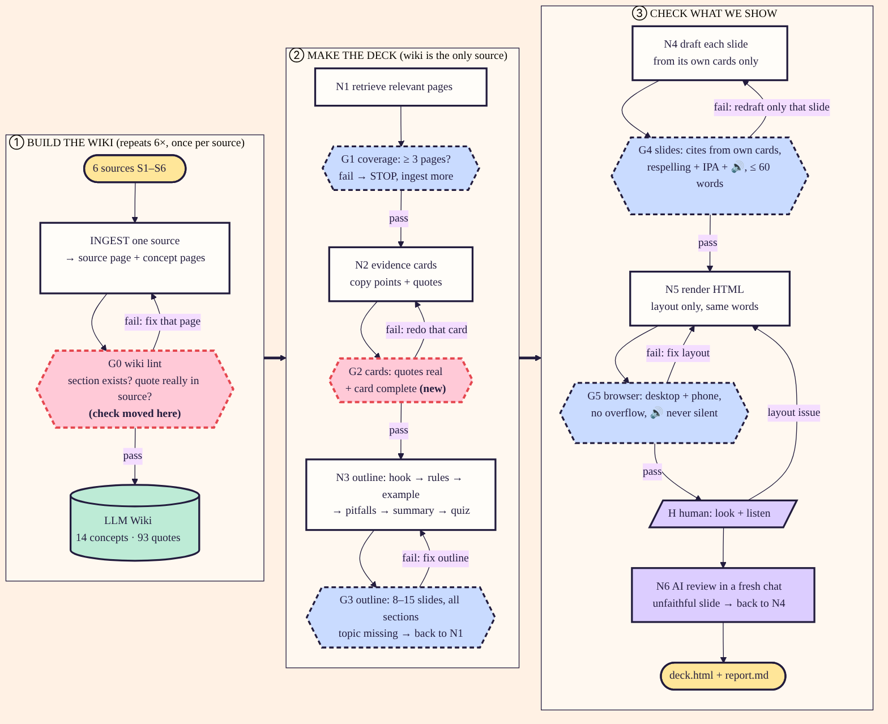

# French Pronunciation LLM Wiki → teaching deck

**Topic:** the basics of French pronunciation, for total beginners who speak English and know zero French.
French doesn't sound like it's spelled (silent endings, nasal vowels, the throaty r, words that link
together), and that's usually the first wall people hit. I built an **LLM Wiki** from 6 sources,
then used it as the *only* source for a **15-slide teaching deck** where every example word has an
English-style respelling, IPA, and a 🔊 button to hear it.

| | |
|---|---|
| **Deck** | https://lakeofpeppi.github.io/GEN_AI_French-Pronunciation-Wiki/topic-pronunciation/deck.html (← → keys, 🔊 to listen, N for teacher notes) |
| **Home page** | https://lakeofpeppi.github.io/GEN_AI_French-Pronunciation-Wiki/ |
| **Wiki** | [`wiki/`](wiki/), start at [`wiki/index.md`](wiki/index.md): 6 source pages, 14 concept pages, 93 quotes checked against the source text |
| **Interview** | [`discussion.md`](discussion.md): the questions I answered *before* anything was generated |
| **Rules** | [`AGENTS.md`](AGENTS.md) (+ `CLAUDE.md` → `@AGENTS.md`), with a change log of every rule added after a failure |
| **Run logs** | [`topic-pronunciation/report.md`](topic-pronunciation/report.md) (deck run) · [`wiki/log.md`](wiki/log.md) (ingest + lint) |

---

## 1. The loop / graph design



<sub>Dashed hexagons = gates (scripts in `pipeline/`). Pink with a red border = a check I added or moved after something failed. Source: [`docs/graph.mmd`](docs/graph.mmd). Full node-by-node spec: [`.agents/workflows/topic-slides.md`](.agents/workflows/topic-slides.md).</sub>

**In one line:**
Ingest source → **lint (G0)** → Retrieve wiki pages → Evidence cards → **check (G2)** → Outline → **check (G3)** → Draft slides → **check (G4)** → Render HTML → **browser check (G5)** → Human look + listen → AI review in a fresh chat.

Every step writes a file into `topic-pronunciation/` (retrieval → cards → outline → drafts → deck), so I can open, re-run or fix any single step without redoing the rest.

### Which steps repeat

| Loop | Repeats | Size |
|---|---|---|
| INGEST ↔ G0 lint | once per source (6×), plus a fix round if lint fails | small |
| N2 ↔ G2 | per card: only the card the check flagged is redone | small |
| N4 ↔ G4 | per slide: only the slide that failed is redrafted | small |
| N5 ↔ G5 | layout only, the words can't change here | small |
| G3 → N1 · N6 → N4 | topic missing from the wiki · slide not faithful to the wiki | **big** (should be rare) |

### Where checking or regeneration happens

- **G0, at ingest:** every key point in the wiki carries `[S# §Section] «verbatim quote»`. The script checks that the section exists and that the quote is *really* in the source text (≥ 6 characters, prose only). If not, I fix that page before ingesting the next source.
- **G1:** fewer than 3 relevant wiki pages → stop and ingest more instead of letting the model fill gaps.
- **G2:** card quotes are real **and** each card has all the wiki's points (not just the first one).
- **G3:** 8–15 slides, and the teaching structure is all there (hook, definition, how it works, rules, example, pitfalls, summary, quiz).
- **G4:** each slide only cites its own cards, every example has respelling + IPA + 🔊, ≤ 60 words.
- **G5:** a real browser opens the deck on desktop and phone: no overflow, arrow keys work, sources on every slide, and 🔊 never fails silently.
- **H + N6:** what scripts can't judge. I look at it and listen to it, then a *fresh* chat that never saw the drafting reviews the slides against the wiki pages.

Brakes: max **3 rounds** per loop, then stop and report. Each round only fixes what the check listed.

### Why it's designed like this

- **A graph, not one big loop.** Evidence, outline, wording and layout have different standards. With one loop, a typo in the layout would mean regenerating everything. With a graph, each failure goes back only to the step right above it.
- **Checks are scripts, not "looks good to me".** The model that wrote something is bad at catching its own mistakes, so every gate is code that gives the same answer every time.
- **Catch errors closest to where they're born.** Bad quotes come from ingest, so the quote check lives at ingest (G0), not three steps later (see Reflection).
- **The wiki is the only source.** The deck can't say anything the wiki can't back up with a quote. That's what keeps the wiki and the slides aligned.

---

## 2. Real run: what actually happened

Full logs: [`report.md`](topic-pronunciation/report.md) and [`wiki/log.md`](wiki/log.md).

| Step | Result |
|---|---|
| INGEST S1–S6 → **G0** | **after S2: FAIL 12** (10 section names with straight vs curly quotes, 1 quote too short, 1 quote from a table the PDF scrambles) → fixed → PASS · **after S5: FAIL 1** (forgot the index) → PASS · final lint over all 6 sources: PASS |
| N1 → **G1** | 12 relevant pages (2 skipped: enchaînement, intonation) → PASS |
| N2 → **G2** | round 1: a bug copied only 1 point per card, **and G2 still passed** → added a completeness check → it failed 12/12 on the buggy cards (proof it works) → re-ran N2: 57 items → PASS. Bad quotes: **0** |
| N3 → **G3** | 15 slides, all teaching sections → PASS |
| N4 → **G4** | PASS first try. Before trusting it, I planted 3 broken slides (no respelling, a cite not in the cards, 84 words): all 3 caught |
| N5 → **G5** | PASS on desktop 1280×720 + phone 390×844 |
| **H** (me, on the finished deck) | quiz answers ran together on one line → render fix only → G5 PASS |
| **G5 extended** | new test: press 🔊 on a device with no French voice → **FAIL: silent button, no warning** → fixed → PASS |
| **N6** AI review | ChatGPT in a fresh chat, given only the slides + cited wiki pages → **FIX, 11/15 PASS** ([`review.md`](topic-pronunciation/review.md)). Slides 07, 10, 13, 14 went back to N4 (the big loop), redrafted from their own cards → G4 PASS → G5 PASS |

### How the wiki and the deck line up

Every slide ends with `Sources: [S# §Section]`, and the chain behind it is checked at each link:

```
slide cite ──G4──► evidence card ──G2──► wiki key point ──G0──► quote really in the source text
```

| Slides | Wiki pages they're built from |
|---|---|
| 01–02 hook, what it is | [spelling-vs-sound](wiki/concepts/spelling-vs-sound.md), [ipa](wiki/concepts/ipa.md) |
| 03–04 rules: silent endings, mute e | [silent-letters](wiki/concepts/silent-letters.md), [schwa](wiki/concepts/schwa.md) |
| 05–08 how sounds work | [vowel-spellings](wiki/concepts/vowel-spellings.md), [front-rounded-vowels](wiki/concepts/front-rounded-vowels.md), [nasal-vowels](wiki/concepts/nasal-vowels.md), [french-r](wiki/concepts/french-r.md), [consonant-spellings](wiki/concepts/consonant-spellings.md) |
| 09–11 accents, liaison, rhythm | [accents](wiki/concepts/accents.md), [liaison](wiki/concepts/liaison.md), [stress](wiki/concepts/stress.md) |
| 12 worked example | silent-letters + liaison |
| 13 pitfalls · 14 summary · 15 quiz | nasal-vowels, liaison, front-rounded-vowels, silent-letters, spelling-vs-sound |

Where the sources **disagree** (is final r pronounced? optional liaisons? what is French stress?), the wiki keeps both sides with citations, and the slide flags it with a "Heads up" note and gives beginners one clear thing to do. (I first listed "3 or 4 nasal vowels?" as a disagreement too, but the AI review pointed out the sources don't actually clash: standard French has up to 4, and many Paris speakers merge two. So the slide now explains it instead of calling it a conflict.)

**Teaching structure:** hook (01) → what it is (02) → rules & how sounds work (03–11) → worked example (12) → pitfalls (13) → summary (14) → quiz (15).

---

## 3. Reflection

Based on two real runs: a **practice run** on "AI Agents" (stopped after drafting, kept in [`practice-run/`](practice-run/)) and this **French run** (full graph).

### Which node is the most error-prone?

**The evidence step: getting a real quote from the source to back each claim.** It failed in both runs:

- **Practice run, G2:** 6 of 31 quotes weren't actually in the source (the PDF text layer moves some Chinese characters around, so "copied" text didn't match). It only passed on round 3 of 3, the stop limit. And one "fix" cut a quote down to `初稿` (2 characters) just to pass, which proves nothing.
- **French run, G0:** after S2, 12 problems: 10 were section names with straight vs curly quotes, 1 quote too short, and 1 quote from a table that the PDF scrambles. After S5 I forgot the index.
- **French run, N2:** a bug copied only the first point of each wiki page into the cards, and **G2 still passed**, because it only asked "is this quote real?", never "is everything here?".

The root causes: PDF text doesn't always match what you see on the page, and an LLM tends to *remember* a quote instead of *copying* it.

### Where did I insert the check earlier?

**I moved the quote check from G2 (the card step, in the middle of the graph) to G0 (right at ingest).**

```
practice run:  ingest ───────────────────────► cards → G2 quote check   (6/31 failed, 3 rounds)
French run:    ingest → G0 quote check ──────► cards → G2 quote check   (0/57 failed at G2)
```

Every wiki key point now stores its quote, and the lint checks it right after each source is ingested. So the error gets caught next to the source it came from, where it's cheap to fix, instead of three steps later when slides already depend on it. In the French run every quote problem showed up at ingest, and G2 found **zero** bad quotes.

Other checks I added because something actually broke (all logged in [`AGENTS.md`](AGENTS.md) §11):

1. **Quotes must be ≥ 6 characters.** A "fix" that makes the evidence weaker isn't a fix.
2. **Ignore quote style, never quote tables.** Curly vs straight quotes is just formatting; table text from a PDF can't be trusted.
3. **G2 also checks completeness** (card items = wiki points).
4. **Test every gate with planted errors** before trusting its PASS. A green check means nothing until you've seen it go red.
5. **G5 presses the 🔊 buttons** (see below).

### Something I didn't expect: the 🔊 buttons

I thought the hard part would be the text. It turned out the **sound** was the part my checks couldn't really see.

- **English letters can't spell French.** `bon ≈ bohn` gets you close, but it tempts you to say the *n*, which is exactly the mistake the nasal-vowel slide warns about. The respelling is a crutch, IPA is precise but beginners can't read it yet, and the 🔊 is what actually teaches the sound. That's why I asked for all three in the interview.
- **A passing check hid a silent button.** G5 counted 27 🔊 buttons and passed, but it never pressed one. When I made it press one in a browser with no voices installed, nothing happened at all: no sound, no warning. The code only warned when *some other* voice existed. Now the warning shows whenever there's no French voice, and G5 fails if a button is ever silent.
- **The sound depends on the device.** The 🔊 uses the browser's built-in voice, so a Mac with a French voice sounds right, while a computer without one might read French with an English accent or say nothing. No script can judge whether a word *sounds* right, only an ear can. So my human check (H) is now **look and listen**, not just look.

Lesson: a check only knows what it can measure. For a pronunciation deck, the most important output, the sound, is the one no script can grade, so that's exactly where a human has to stay in the loop.

### What the AI review caught that my scripts couldn't

All my gates passed, and the fresh-chat review still sent back **4 of 15 slides**. Every quote was real, but the *meaning* was off in small ways: "parlent ends in l" mixes up spelling and sound, the summary put CaReFuL (letters you **do** pronounce) in a line about silent endings, and liaison sounded automatic when it only happens in certain spots. The info to fix all of it was already in the cards; the drafting step just squeezed it too hard to fit 60 words. Scripts check *is it backed up?*; only a reader can check *will a beginner get the wrong idea?*. That's why the review has to come from a fresh chat (here a different AI), not the one that wrote the deck.

### Did I change the workflow? Why?

Yes. The graph above is the *after* version: G0 was added at ingest, G2 got a completeness check, G5 got the 🔊 test, and H became look + listen. Each change came from a real failure, not a guess. The two things I kept on purpose are the human check and the AI review in a **fresh** chat, because whoever wrote the deck shouldn't be the only one grading it.

---

## Sources & honesty

- **S1** *Introduction to French Level I*, "Prononciation — Les bases du français 101" (Pressbooks, CC BY 4.0) · **S2** Duolingo Blog, "How to pronounce French" · **S3** Wikipedia, *French phonology* · **S4** Wikipedia, *Help:IPA/French* · **S5** Wikipedia, *French orthography* · **S6** Wikipedia, *Liaison (French)*. Details in [`raw/sources.md`](raw/sources.md).
- Quotes are short, attributed, and used to back each claim. The source PDFs and their extracted text are **not** in this repo (copyright); they stay on my computer.
- I built this project myself, using an AI (Chatgpt) tutor whenever I got stuck, felt lost, or needed guidance throughout the development process.

## Re-run it

```bash
python3 pipeline/check.py wiki                          # G0 lint (needs raw/text/, kept local)
python3 pipeline/check.py coverage topic-pronunciation  # G1
python3 pipeline/make_cards.py topic-pronunciation      # N2
python3 pipeline/check.py cards topic-pronunciation     # G2
python3 pipeline/check.py outline topic-pronunciation   # G3
python3 pipeline/check.py slides topic-pronunciation    # G4
python3 pipeline/render.py topic-pronunciation          # N5
node pipeline/render_check.js topic-pronunciation       # G5 (needs playwright)
python3 pipeline/make_review_packet.py topic-pronunciation  # N6 packet → paste into a NEW chat
```
